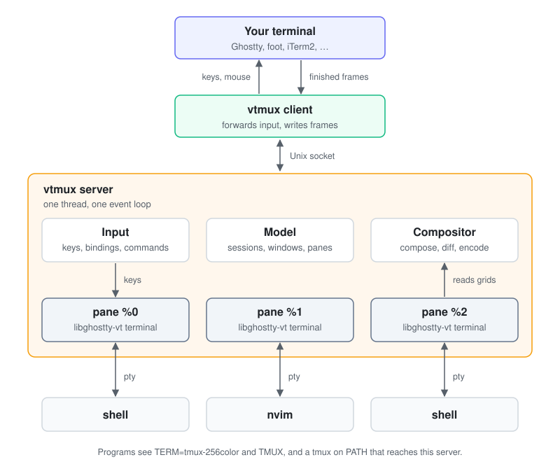
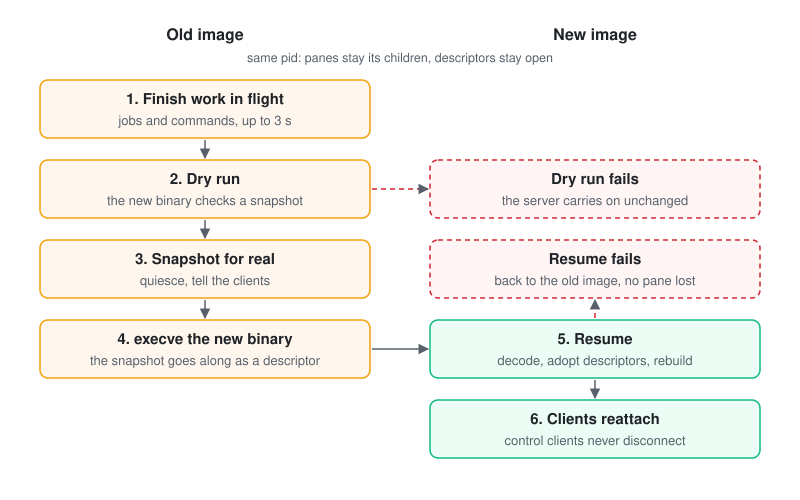
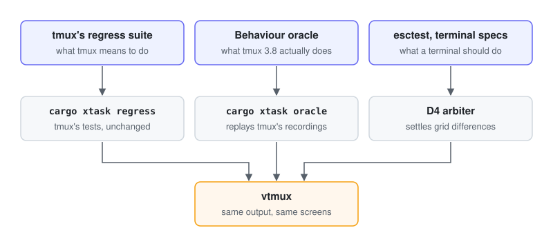

# How vtmux works

vtmux has tmux's process model. A server owns every session, window, pane and shell. Each `vtmux` (or `tmux`) invocation is a short-lived client that talks to it over a Unix socket; an attached client also owns your real terminal.

Each pane's screen lives in its own libghostty-vt terminal inside the server, where tmux has `grid.c` and `input.c`. Everything a script can read is still shaped like tmux. The decisions behind this are numbered (D1, D2, …) and indexed in [docs/README.md](README.md).

## The big picture

<picture>
  <source media="(prefers-color-scheme: dark)" srcset="images/architecture-overview-dark.svg">
  
</picture>

- **The socket** is `$TMUX_TMPDIR/vtmux-UID/<label>`, or `tmux-UID/<label>` when the binary runs as `tmux` (D20): the file name in `argv[0]`, so a link named `tmux` counts and a shell alias does not. Over it runs vtmux's own framed protocol (`vtmux-core::protocol`).
- **The client** puts your terminal in raw mode, forwards what you type, writes each frame as it arrives and acknowledges it.
- **The server** is one thread on a mio event loop. `input.rs` turns bytes into keys and runs their bindings or sends them to the active pane. Options, formats, targets and hooks are pure code in `vtmux-core`. The compositor in `render/` draws each client's screen (see *Output* below).
- **Each pane** is a `PaneTerm` (`vtmux-vt`) around a libghostty-vt terminal, holding the grid and its scrollback. It answers a program's queries as tmux would.

## The crates

| Crate | Job |
|---|---|
| `vtmux-core` | Pure tmux semantics, no I/O: command parser and table, targets, formats (with a POSIX regex engine), options, styles, keys, layouts, socket paths, the client/server protocol, tmux's exact error texts. |
| `vtmux-vt` | The FFI crate: a safe wrapper over libghostty-vt that shapes Ghostty's terminal as tmux (`capture-pane`, query replies, cursor and history). Exports and imports a pane's whole terminal state for live upgrade, and refuses a malformed one. |
| `vtmux-server` | The event loop and everything stateful: model, ptys and processes, commands, control mode, compositor, live upgrade. OS calls live in `sys/`. |
| `vtmux-client` | The attached client: raw mode, input, frames, resize, signals, restoring the terminal on exit. |
| `vtmux-snapshot` | The live-upgrade format: versioned, tagged records, its own types so a server refactor can't change it. |
| `vtmux` | The binary: global flags, connect-or-start, then a command, attach or control mode. |
| `xtask` | Test tooling: the reference tmux build, the regress runner, the behaviour oracle, socket reaping. |

Under `vtmux-vt` sit `vtmux-ghostty-vt` and `vtmux-ghostty-vt-sys` (`third_party/libghostty-rs`, outside the workspace): libghostty-rs's `libghostty-vt` and `libghostty-vt-sys`, forked, published under vtmux's names. The sys crate's build script downloads the pinned libghostty-vt release and its Zig packages, checks their SHA-256, applies vtmux's patches and builds it with Zig, which fetches nothing (`VENDOR.md` there). Every crate but `xtask` is published to crates.io, in dependency order ([RELEASING.md](RELEASING.md)).

`unsafe` is allowed only in `vtmux-vt` and `vtmux-server/src/sys/`. Every other crate is `#![forbid(unsafe_code)]` (D10).

## Output: a program prints

1. The server reads the pane's pty and feeds the bytes to its libghostty-vt terminal. A query (DA, cursor position) is answered in tmux's words, not Ghostty's.
2. Once per loop tick, the compositor (`render/`) builds each attached client's screen: panes at their layout cells, borders, status line, menus and popups. Each pane keeps one Ghostty render state that re-reads only dirty rows, once per write however many clients and views look, and each client caches its composed rows, so a one-cell change recomposes one row. A tick where nothing changed builds no frame, and a tick that only takes clients' frame acknowledgements does not render at all.
3. The screen is diffed against the client's last frame, only between the first and last changed cell of each changed row, and only the changed cells are encoded for that client's terminal (`terminal-features`, D8, with its terminfo entry from a generated table: vtmux reads no terminfo), inside synchronized output, with the cursor placed once at the end.
4. The client writes the frame and acknowledges it.

Steps 2 and 3 are why the cursor doesn't jump under heavy output (D14): tmux forwards each pane update as it happens, vtmux only sends finished pictures. Pane blend (D26, `render/blend.rs`) works for the same reason: the compositor can change every cell's colour before encoding.

**Shared frames.** Clients that show the same window at the same size, view and terminal share the drawing and the frame bytes within a tick (`render/share.rs`). The time and each pane's foreground process are read once per tick (`live.rs`) so every client sees the same; a drawing that reads its own client (`#{client_prefix}`) is not shared. Each client still gets the bytes it would get alone, and debug builds redraw every shared frame to check.

**Backpressure.** A client with an unwritten frame gets no new one; its acknowledgement brings the next, with everything that changed meanwhile (tmux's `server_client_check_redraw`). A flooding pane's frames go at most every 10 ms, but a key's echo goes at once. A stalled client gets one full frame when it catches up (tmux's `tty_block_maybe`). A pane in synchronized output (`?2026h`) is drawn from the screen it showed when the mode began, for at most a second (tmux's `MODE_SYNC`).

## Input: you press a key

1. The client forwards the bytes. The server decodes them into keys as tmux's `tty-keys.c` does, and swallows the terminal's replies to vtmux's own queries. It reads a client's input 4 KB a loop turn, as tmux reads a terminal, so a paste or a flood of keys can't starve commands, panes or other clients.
2. A mouse report is located (`mouse.rs`: pane, border, status range) and becomes a key such as `MouseDown1Pane`.
3. A key with a binding runs its command; any other is encoded for the active pane's modes and queued for its pty, written once the keys at hand are handled. A program granted the kitty keyboard protocol (D29) gets libghostty's encoding instead (`pane_kitty.rs` ends the grant when the program that asked exits).

## Commands and control mode

A command client connects (starting the server if needed and allowed), sends `Hello` with argv, cwd, environment and tty, and gets `Stdout`, `Stderr` and `Exit` back. Those match tmux 3.8 byte for byte, exit codes and errors included, because scripts depend on that edge. Run as `tmux`, the socket may be a real tmux server's (D20): a client whose `Hello` is answered with tmux's `MSG_VERSION` says so; one that gets no answer within 200 ms, or a close, first asks the socket with an imsg header that a vtmux server drops unread (`foreign.rs`).

Commands run on per-client queues (`cmdq.rs`, after `cmd-queue.c`), plus a global one for the config and `run-shell -b`. `wait-for`, file I/O, `run-shell` and `if-shell` hold their queue without blocking the loop. Jobs and `#()` formats are `/bin/sh -c` children read through the same loop (`jobs.rs`, `format_jobs.rs`).

Inside panes, plugins call plain `tmux`. The server puts a private directory with `tmux` → its own binary first on every pane's `PATH` (`shim.rs`, D5), so they reach this server whatever `tmux` is installed.

Control clients (`-C`) get tmux's `%begin`/`%end`, `%output` and notifications instead of frames, with tmux's backpressure (`control_queue.rs`, after `control.c`): `pause-after` pauses a pane whose oldest unsent output is too old, a client 300 s behind is dropped, and a pane is not read while every attached client is a control client that is behind. A control client's stdin is read 4 KB a turn like a terminal's input, so a script can't hold up other clients, and the output of the lines one read brings goes out in one write.

## Live upgrade

`vtmux-upgrade [-b binary]` (D27, [live-upgrade spec](specs/2026-11-06-live-upgrade.md)) replaces the server's image with `execve`, so the pid stays: pane processes remain its children and every descriptor it keeps stays open.

<picture>
  <source media="(prefers-color-scheme: dark)" srcset="images/live-upgrade-dark.svg">
  
</picture>

- **Dry run.** Before the dry run, the server asks the new binary for its patch stack (`--vtmux-patch-stack`); if it matches, all history is compressed first, on threads. The snapshot goes to the new binary in a memfd (`--vtmux-check-snapshot`), which decodes and rebuilds it while the server keeps serving, within 3 s plus 1 s per 100k rows. It passes only if the binary answers the snapshot's digest on stderr, or `-V` says 3.8-beta1 or beta2.
- **The switch.** The server quiesces, flushes clients, snapshots again and sends each attached client an `UpgradeNotice` with a token. It then runs `execve(B --vtmux-resume <fd>)`, keeping the listener, client sockets, ptys and `pipe-pane` descriptors open. The new image decodes, adopts those descriptors, rebuilds, reaps and answers the client that asked. An attached client resets its terminal, keeps it raw and execs `B --vtmux-reattach <socket>`, which binds it to its old record.
- **Frozen frames.** A few protocol frames never change (`Hello`, `Stdin`, `StdinEof`, `Stdout`, `Stderr`, `Exit`, `Exec`, `Flags`, and `UpgradeRequest`/`UpgradeResult`/`UpgradeNotice`), so control clients of any version from protocol 9 on stay served and a newer client can ask an older server to upgrade. Every other frame may change with a protocol bump.
- **No typing lost.** An attached client reads the server between reads of the terminal, so a flood of typing never hides the notice, and its terminal stays raw across the exec, its own settings handed to the new image in `VTMUX_REATTACH_TTY` (only for a binary whose dry run says it takes them).
- **Failure never loses panes.** A failed dry run leaves the server as it was. A resume that fails switches back to the old image on the same descriptors (Linux: `fexecve` of the executable it kept open). Failing that, it serves without the parts that don't read, then without terminal state, then with no sessions while it holds every pty open. Exit status: 0 upgraded, 1 not, 2 upgraded short of a part.
- **History fast path.** With the same Ghostty patch stack, compressed history pages travel as Ghostty's own bytes and nothing is decoded. Across stacks they go as vtmux rows (details in `VENDOR.md` and the live-upgrade spec).
- **What closes.** What an upgrade closes by design (tree modes, prompts, menus) is listed in `server/snapshot.rs`.

## Terminal protocols tmux drops (D28)

vtmux passes through a protocol tmux 3.8 drops only when libghostty-vt implements it in panes and Ghostty as the outer terminal. Each is a server option, off by default and tmux byte for byte when off, and only a program that asks sees it. A grant outlives the option being turned off and survives a live upgrade.

| | Option | Where |
|---|---|---|
| Kitty keyboard (D29) | `vtmux-kitty-keys` | Ghostty's key encoder via `vtmux_vt::kitty_keys`; grants in `pane_kitty.rs` |
| Desktop notifications, OSC 9 and 777 (D30) | `vtmux-notifications` | `notify.rs`: to Ghostty clients only, at Ghostty's rate limits |
| In-band resize, mode 2048 (D31) | `vtmux-inband-resize` | `resize.rs` |
| Kitty graphics (D33) | `vtmux-graphics`, `vtmux-graphics-limit` | Ghostty's image storage per granted screen, images sent inline only, `pane_graphics.rs` (grants, the shared limit over images and loads in progress); drawn as unicode placeholder cells for Ghostty clients, each with its own uploads, in `render/graphics.rs` |

## Ghostty inside

libghostty-vt runs inside the server, once per pane: the "grid follows Ghostty" half of D4. Where the two emulators differ, the difference is recorded with evidence in [compat/DIVERGENCES.md](../compat/DIVERGENCES.md).

It is vendored in `third_party/libghostty-rs`, pinned to a libghostty-vt release (tracked by tag, never by commit), with local patches applied at build time (`libghostty-vt-sys/patches`). `VENDOR.md` records the pin and explains each patch. The patches cover:

- **tmux's grid shape:** wrap and pending-wrap bookkeeping, cells used, reflow as tmux does it (a line keeps its cells past a narrower width), the alternate screen, clusters and widths, hyperlink ids, line flags, DECAWM, DECALN.
- **Memory:** bounded, resumable page compression and resize without faulting blank pages; grid-reference bounds checked before native reads.
- **Library safety:** process-wide Unicode options are one atomic pointer to an immutable width table plus one atomic flag byte, read once per print call, so another thread may set them while a terminal prints, with no lock on the print path.
- **Live upgrade:** whole-state export and import, page by page.
- **Speed:** cloning a screen and whole pages as memory, stepping row to row instead of walking the page list, reading the primary history in place while the alternate screen is up.
- **Kitty graphics (D33):** image storage per granted screen, a pane's storage limit and its unfinished loads held to it, a decode capped at the screen's limit.

A build reports its patch stack (`--vtmux-patch-stack`); live upgrade uses it to decide whether compressed pages can travel as they are.

Quiet scrollback is compressed in place (`compress.rs`): five seconds after a pane's history last changed, one bounded step at a time across panes, only when the loop is idle. A pane that streams for 10 s is compressed in small steps at the end of busy turns too. Reading compressed history restores it transparently.

If your terminal is Ghostty, the finished picture is parsed again by Ghostty's own libghostty. That is the price of a drop-in tmux that works in any terminal and over SSH.

## Compatibility is at the edge

Inside, vtmux is ordinary Rust: IDs are newtypes, values are enums, windows hold a typed layout tree, state lives in ID-keyed arenas. Errors are typed until they reach the edge, where they become tmux's exact text. Where tmux's behaviour falls out of its data structures (sessions listed by name, IDs never reused, hook order), vtmux reproduces it explicitly and a test pins it.

## How it's tested

<picture>
  <source media="(prefers-color-scheme: dark)" srcset="images/testing-dark.svg">
  
</picture>

- **Regress:** tmux's own tests from the 3.8 tag, unchanged, run against the vtmux binary and scored by `compat/expected.toml`. The gate fails when a test regresses and when one passes unmarked.
- **Oracle:** Scenarios recorded once against real tmux 3.8 and replayed against vtmux. Screens are compared as grids in an observer terminal, never as raw bytes. The replay runs again with a live upgrade after every third step (the scenarios an upgrade changes by design are skipped, each with its reason, in `oracle/upgrade-every-skip.toml`).
- **Terminal specs:** where vtmux's grid differs from tmux's, esctest and the specs decide which emulator is right (D4).
- **Side by side:** the CLI, attach and control tests run each case against both binaries.
- **Plugins:** tmux-resurrect and tmux-continuum (vendored in `compat/tmux-plugins`) save, kill the server and restore on both binaries; what was saved and what came back must match, also when the other binary restores the save.

`scripts/check.sh` runs all of it, on Linux and macOS in CI, where each of its stages is a job of its own. Numbers against tmux: [PERFORMANCE.md](PERFORMANCE.md).
